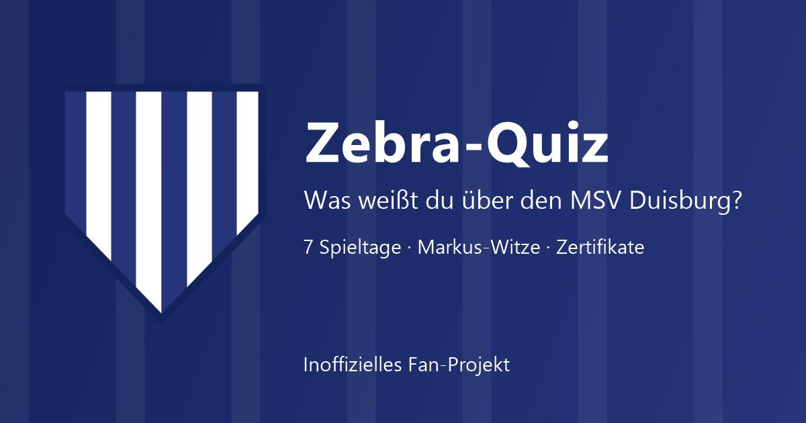

**Live ansehen: [https://nosz.github.io/msvduisburg](https://nosz.github.io/msvduisburg)**

# Zebra-Quiz: MSV Duisburg

Inoffizielles Fan-Projekt (ohne Verbindung zum MSV Duisburg). Gleiche Technik und gleicher Aufbau wie das Knappen-Quiz (SCHALKE), Inhalte komplett neu. Der Hinweis „Website Design by Norbert“ steht im Fuß der Startseite und ist ein Link auf https://nosz.github.io/norbert-szpak/.

**Datei:** `index.html` (eine Datei, offline lauffähig, Version 1.0.1, Stand 24.10.2026). Einfach im Browser öffnen oder auf einem Webserver ablegen.

> **Veröffentlichung:** GitHub-Repository `msvduisburg` (Benutzer `nosz`), Adresse `https://nosz.github.io/msvduisburg/`. Alle Dateien der Liste unten ins Hauptverzeichnis des Repositories legen (ohne Unterordner), GitHub Pages auf den Hauptzweig stellen.

## Inhalt
Fan-Quiz mit 7 Spieltagen, Markus-Witzen, Zertifikaten und Personalisierung, in **Deutsch, Englisch und Ruhrpott** (Umschalter oben, wird gespeichert).

| Nr. | Spieltag | Fragen |
|---|---|---|
| 1 | Blitzstart: Zebras in 60 Sekunden | 4 |
| 2 | Das Trainerteam 2026/27 | 4 |
| 3 | Der Kader in Zahlen | 4 |
| 4 | Nummern und Neue | 4 |
| 5 | Hinter den Kulissen | 4 |
| 6 | Zebras im Netz und im Stadion | 4 |
| 7 | Bossrunde: Das Spiel in Ingolstadt | 5 |

- **Markus-Witz & Fakt:** Karte auf der Startseite mit 15 Sprüchen und Fakten, Knopf „Noch einer!“ zeigt den nächsten.
- **Der kleine Markus:** Ab und zu läuft ein Pixel-Männchen mit Mütze und schwarzer Sonnenbrille über den Bildschirm (rein dekorativ, nicht klickbar, aus bei „Bewegung reduzieren“, abschaltbar über das Sonnenbrillen-Symbol in der Kopfzeile). Er erzählt ständig Witze im Stil von Markus Krebs, spricht in der eingestellten Sprache (Deutsch, Englisch, Ruhrpott), fragt ohne Namen drängender danach (höchstens sechsmal) und lobt nach dem Eintragen. Die Witze stammen aus `info\witze.txt`, es werden kein echter Name als Figur, keine Fotos und keine Bilder verwendet. Test mit Adresse `?lauf=witz` (weitere: `name`, `gruss`, `lob`, `kneipe`, `currywurst`, `tor`, `fass`, `karriere` u. a.).
- **Spielmechanik:** 10 Tore je richtiger Antwort, 1 bis 3 Sterne je Spieltag, 5 Ränge von „Zebra-Küken“ bis „Zebra-Legende“, Konfetti, Hell- und Dunkelmodus, Zertifikat je Spieltag und Meister-Zertifikat (PNG speichern, drucken, teilen).
- **PWA:** installierbar, läuft offline, Update-Hinweis. Dateien (alle ins Hauptverzeichnis): `index.html`, `manifest.webmanifest`, `sw.js`, `icon-192.png`, `icon-512.png`, `icon-maskable-512.png`, `favicon.png`, `favicon.svg`, `apple-touch-icon.png`, `msvduisburg_vorschau.jpg`. Bei jeder neuen Version `VERSION` in `index.html` **und** `sw.js` gemeinsam erhöhen. Die Ordner `tests/`, `bau/` und `info/` sind nur für die Entwicklung und werden nicht hochgeladen.

## Marke und Look
Marineblau und Weiß, nach dem Auftritt von msv-duisburg.de aus einem Screenshot (`info\farben.png`) geschätzt. Es werden **kein Vereinswappen, keine Logos, keine Spielerfotos und keine kopierten Texte** verwendet. Das Zeichen ist ein selbst gezeichnetes, einfaches blau-weißes Streifen-Schild. Aus Datenschutzgründen werden keine Geburtsdaten genannt.

## Bau
`bau\bau.ps1` baut `index.html`, `manifest.webmanifest` und `sw.js` aus dem Gerüst SCHALKE und den Inhalten in `bau\*.src.txt` (Paare `<<Deutsch||English>>`, der Ruhrpott-Text entsteht regelbasiert aus dem Deutschen). `bau\bilder.ps1` erzeugt Symbole und Vorschaubild.

## Quellen (Stand 22.10.2026)
- Profi-Seite des Vereins (Kader 2026/27, Trainerteam, Funktionsteam, News): https://www.msv-duisburg.de/mannschaften/profis/ und https://www.msv-duisburg.de/ (gespeichert in `info\info_msv_duisburg.txt`)
- Wikipedia (DE): https://de.wikipedia.org/wiki/MSV_Duisburg (gespeichert in `info\info_msv_duisburg._wikipedia.txt`)
- Witze: `info\witze.txt`

## Bekannte Grenzen
- Kader, Trainerteam und News sind Momentaufnahmen vom 22.10.2026 und ändern sich; Wikipedia ist eine Sekundärquelle. Fragen und Texte wurden nicht von einer zweiten Person gegengelesen.
- Die Ruhrpott-Texte sind regelbasiert aus dem Deutschen erzeugt, spielerisch gemeint und keine Rechtschreibnorm; Dialekt-Profis dürfen korrigieren. Die englischen Texte sollten Muttersprachler gegenlesen.
- Die Links zum Verein sind nicht automatisch geprüft.
- Vor einer öffentlichen Veröffentlichung Marken- und Stil-Anlehnung mit Management/Legal klären (Markus-Krebs-Stil, Vereinsname).

## Änderungsprotokoll
- 1.0.1 (24.10.2026): Teilen und Zertifikat-Download in App-Browsern (Facebook, Instagram, Messenger) repariert: Erkennung mit Hinweis „Im Browser öffnen“, Zertifikat-Bild zum Speichern per langem Druck, Fehlerbehandlung beim Download.
- 1.0.0 (24.10.2026): Erstfassung, gebaut aus dem Gerüst SCHALKE (Version 1.1.5): Zebra-Quiz mit 7 Spieltagen, kleinem Markus mit Mütze und Sonnenbrille (Witze), Namensfrage, Lob, Installieren-Knopf, Zertifikaten, Pflicht-Elementen (Autoren-Knopf, Speichern-Knopf, kein automatisches Scrollen) und Test-Suite.
