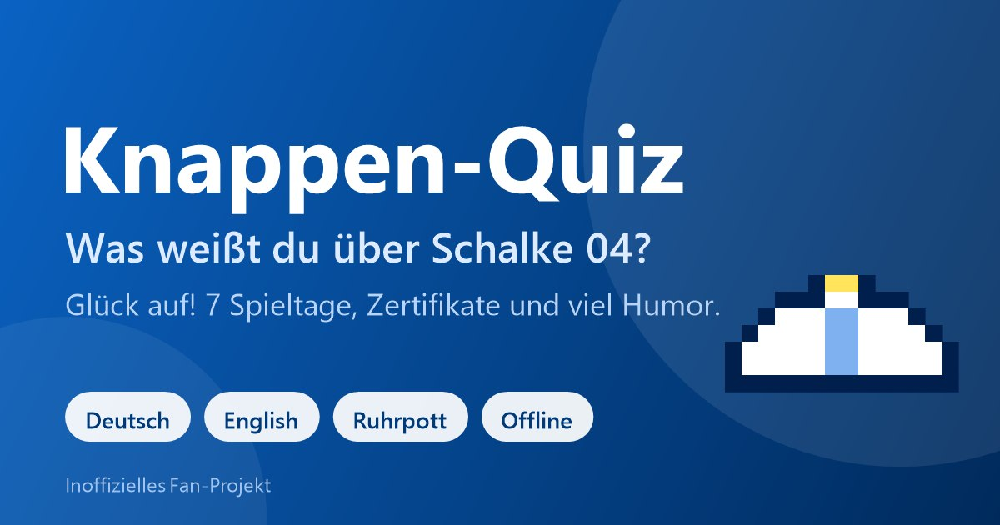

**⚽ Live ansehen: [https://nosz.github.io/schalke](https://nosz.github.io/schalke)**

# Knappen-Quiz: Schalke 04

**Von Wintzi und Nobbe** (inoffizielles Fan-Projekt von Schalke-Fans). Der Hinweis „von Wintzi und Nobbe“ steht oben in der Kopfzeile unter dem Titel (alle drei Sprachen), in der Fußzeile der Startseite und auf jedem Zertifikat. Gleiche Technik und gleicher Aufbau wie das Stammtisch-Quiz (FCBAYERN), Inhalte komplett neu.

**Datei:** `index.html` (eine Datei, offline lauffähig, Version 1.1.1, Stand 20.10.2026). Einfach im Browser öffnen oder auf einem Webserver ablegen.

> **Veröffentlichung:** GitHub-Repository `schalke` (Benutzer `nosz`), Adresse `https://nosz.github.io/schalke/` . Alle Dateien der Liste unten ins Hauptverzeichnis des Repositories legen (ohne Unterordner), GitHub Pages auf den Hauptzweig (Branch) stellen. Bei anderer Adresse in `index.html` (canonical, og:url, og:image, twitter:image, `SHARE_URL`), in `manifest.webmanifest` (`id`) und in dieser README anpassen.

## Inhalt
Fan-Quiz mit 7 Spieltagen, viel Humor, Zertifikaten und Personalisierung, in **Deutsch, Englisch und Ruhrpott** (Umschalter oben, wird gespeichert).

| Nr. | Spieltag | Fragen |
|---|---|---|
| 1 | Blitzstart: 1904 in 60 Sekunden | 2 |
| 2 | Die Meisterjahre | 2 |
| 3 | Legenden: Kuzorra, Szepan & Co. | 4 |
| 4 | Europa: Eurofighter und Meister der Herzen | 4 |
| 5 | VELTINS-Arena & Nordkurve: Zahlen zum Staunen | 4 |
| 6 | Spitznamen & Tradition: Glück auf | 4 |
| 7 | Bossrunde: Das Revierderby | 5 |

- **Kumpel-Spruch & Fakt:** Karte auf der Startseite mit 14 Sprüchen und Fakten, Knopf "Noch einer!" zeigt den nächsten.
- **Startseite:** "Glück auf! Was weißt du über Schalke 04?" mit zwei Wegen. Name optional, nur lokal gespeichert, steckt in Begrüßung, Quiz, Ergebnis und Zertifikat.
- **Spielmechanik:** 10 Tore je richtiger Antwort, 1 bis 3 Sterne je Spieltag, 5 Ränge von "Grubenlehrling" bis "Knappen-Legende", Konfetti, Hell- und Dunkelmodus.
- **Zertifikate:** je Spieltag ein "Knappen-Zertifikat", zum Abschluss das "Meisterschalen-Zertifikat" (PNG speichern oder drucken).
- **Der kleine Bergarbeiter:** Ab und zu läuft ein Pixel-Männchen mit Grubenhelm über den Bildschirm (rein dekorativ, nicht klickbar, aus bei „Bewegung reduzieren“). Er spricht immer Ruhrdeutsch, egal welche Sprache eingestellt ist, und macht viele Witze über Borussia Dortmund (und einige über andere Vereine), immer respektvoll und mit Augenzwinkern. Zu Beginn kommt er sofort: ohne Namen fragt er immer drängender danach und zeigt auf das Eingabefeld (höchstens sechsmal), mit Namen macht er einen kurzen Witz und sagt „Ich komm wieder, <Name>!“. Trägt jemand den Namen ein, kommt er zum Loben zurück. Test mit Adresse `?lauf=witz` (weitere: `name`, `gruss`, `lob`, `kneipe`, `currywurst`, `tor`, `fass`, `karriere` u. a.).
- **Installieren-Knopf:** Auf der Startseite steht direkt nach Begrüßung und Namensfrage „Mir gefällt die App, ich möchte sie installieren“ (nur solange die App nicht installiert ist).
- **PWA:** installierbar, läuft offline, Update-Hinweis. Dateien (alle ins Hauptverzeichnis): `index.html`, `manifest.webmanifest`, `sw.js`, `icon-192.png`, `icon-512.png`, `icon-maskable-512.png`, `favicon.png`, `favicon.svg`, `apple-touch-icon.png`, `schalke_vorschau.jpg`. Bei jeder neuen Version `VERSION` in `index.html` **und** `sw.js` gemeinsam erhöhen. Der Ordner `tests/` ist nur für die Entwicklung und wird nicht hochgeladen.

## Marke und Look
Königsblau und Weiß mit kräftigen Überschriften, nach dem Auftritt von schalke04.de aus einem Screenshot geschätzt, nicht aus dem Quelltext der Seite. Es werden **kein Vereinswappen, keine Logos, keine Spielerfotos und keine kopierten Texte** verwendet. Das Logo ist ein selbst gezeichneter Pixel-Grubenhelm. Die Seite ist ein inoffizielles Fan-Projekt ohne Verbindung zum FC Gelsenkirchen-Schalke 04 e. V.

## Quellen (Stand 18.10.2026)
- Schalke 04, Erfolge und Epochen: https://schalke04.de/verein/tradition/erfolge/ und https://schalke04.de/verein/tradition/epochen/
- Wikipedia (DE): https://de.wikipedia.org/wiki/FC_Schalke_04 und die in den Lektionen genannten Einzelartikel

## Bekannte Grenzen
- Wikipedia ist eine Sekundärquelle. Zahlen (Titel, Kapazität, Derby-Bilanz) ändern sich; offizielle Werte gibt es beim Verein. Fragen und Texte wurden aus den genannten Quellen übernommen, aber nicht von einer zweiten Person gegengelesen.
- Die Ruhrpott-Texte sind spielerisch gemeint und keine Rechtschreibnorm; Dialekt-Profis dürfen korrigieren. Die englischen Texte sollten Muttersprachler gegenlesen.
- Die Links zu schalke04.de sind nicht automatisch geprüft.
- Vor einer öffentlichen Veröffentlichung Marken- und Stil-Anlehnung mit Management/Legal klären.

## Änderungsprotokoll
- 1.1.1 (20.10.2026): Im Fuß der Startseite steht neben der Version statt des Datums der Link „Created by Norbert“ (gleiches Design, öffnet https://nosz.github.io/norbert-szpak in einem neuen Tab).
- 1.1.0 (18.10.2026): Der kleine Bergarbeiter spricht jetzt in der oben im Menü eingestellten Sprache (Deutsch, Englisch oder Ruhrdeutsch, alle Texte in jeder Sprache; bei Sprachwechsel meldet er sich gleich neu) und lässt sich abschalten: Symbol ⛏️ in der Kopfzeile. **Teilen-Knopf überall und am auffälligsten:** Ergebnisseite, jede Zertifikat-Seite (auch Meister), Übersicht der Zertifikate und Lektionskarten; groß, gefüllt, ganz oben, mit dem Teilen-Symbol der Kopfzeile, „Nächster Spieltag“ darunter, „Als Bild speichern“ und „Drucken“ klein. Der Teilen-Text hängt vom Zertifikat ab, enthält das Ergebnis und den Link zur App. **Urkunde:** Sprache immer wie im Menü, Kasten „Das habe ich gewusst“ mit allen Fragen und richtigen Antworten (zu lange Texte werden kleiner und umbrochen), Fußzeile mit dem Hinweis steht im Rahmen und ist gut lesbar.
- 1.0.0 (18.10.2026): Erstfassung, gebaut aus der Technik des FCBAYERN-Projekts (Version 1.9.0): Knappen-Quiz mit 7 Spieltagen, kleinem Bergarbeiter (Ruhrdeutsch, viele Dortmund-Witze), Namensfrage, Lob, Installieren-Knopf, Zertifikaten und Test-Suite.
